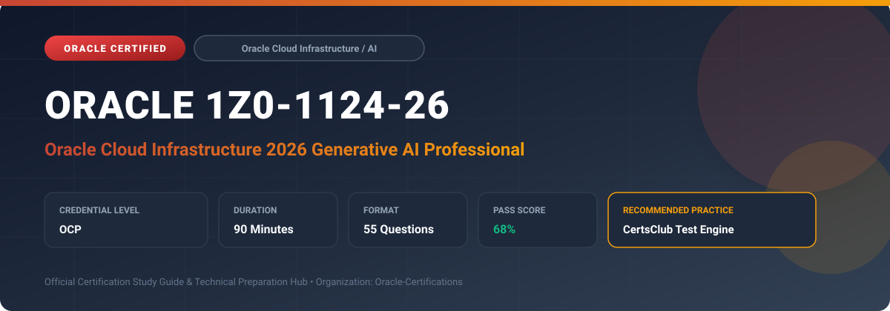

  

# Oracle 1Z0-1124-26: Oracle Cloud Infrastructure 2026 Generative AI Professional

---

## 1. Exam Overview & Candidate Profile

The **Oracle 1Z0-1124-26: Oracle Cloud Infrastructure 2026 Generative AI Professional** certification validates advanced AI engineers architecting, tuning, and deploying generative AI solutions on OCI.

Candidates validate deep technical mastery across OCI Generative AI Service, Dedicated AI Clusters, fine-tuning methodologies (T-Few, LoRA), Retrieval-Augmented Generation (RAG), OCI Generative AI Agents, and vector embeddings.

### Target Audience & Prerequisites
- **Target Roles**: Implementation Specialists, Cloud Architects, Technical Leads, Enterprise Consultants, and Systems Engineers.
- **Recommended Experience**: 1–2 years of practical, hands-on experience designing, implementing, and maintaining corresponding Oracle solutions.
- **Credential Earned**: OCP Certification.

---

## 2. Key Exam Specifications

| Specification | Details |
| :--- | :--- |
| **Exam Code** | **Oracle 1Z0-1124-26** |
| **Official Title** | Oracle Cloud Infrastructure 2026 Generative AI Professional |
| **Certification Track** | Oracle Cloud Infrastructure / AI |
| **Exam Duration** | 90 Minutes |
| **Number of Questions** | 55 Questions |
| **Passing Score** | 68% |
| **Question Format** | Multiple Choice (Single/Multiple Answer), Scenario-Based Questions |
| **Delivery Provider** | Oracle University / Pearson VUE (Online Proctored or Test Center) |
| **Recommended Practice Engine** | [CertsClub Oracle Practice Tests](https://www.certsclub.com/oracle/1z0-1124-26-dumps.html) |

---

## 3. Official Blueprint & Exam Domain Breakdown

The examination assesses candidate competencies across core functional domains weighted as follows:

| Domain Area | Weighting |
| :--- | :--- |
| **OCI Generative AI Architecture & Foundational Models** | `25%` |
| **Dedicated AI Clusters (Hosting & Fine-Tuning)** | `25%` |
| **Fine-Tuning Techniques (T-Few, Parameter-Efficient Tuning)** | `20%` |
| **RAG Architecture & OCI Generative AI Agents** | `20%` |
| **Security, LangChain Integration & Enterprise Governance** | `10%` |

---

## 4. Deep Dive into Complex & Challenging Technical Topics

To secure a passing score on the 1Z0-1124-26 exam, candidates must master the following advanced concepts:

- Evaluating pretrained models: Cohere Command/Embed and Meta Llama models on OCI.
- Provisioning Dedicated AI Clusters for custom model hosting versus model fine-tuning.
- Executing Parameter-Efficient Fine-Tuning (PEFT) using T-Few and LoRA to reduce compute overhead while optimizing domain accuracy.
- Implementing enterprise Retrieval-Augmented Generation (RAG) with OCI Generative AI Agents, OpenSearch, and Oracle 23ai AI Vector Search.
- Developing Python applications using LangChain, OCI GenAI SDK, and streaming responses.

---

## 5. Scenario-Based Demo & Practice Questions

### Question 1
What is the primary architectural advantage of using T-Few parameter-efficient fine-tuning on OCI Dedicated AI Clusters compared to full model weight fine-tuning?

A) It updates only a tiny fraction of model weights (under 1%), dramatically reducing training time and cost while preventing catastrophic forgetting
B) It requires no training data whatsoever
C) It only works on CPUs
D) It deletes the base foundational model

- **Correct Answer**: `A) It updates only a tiny fraction of model weights (under 1%), dramatically reducing training time and cost while preventing catastrophic forgetting`  
- **Technical Explanation**: T-Few updates a minimal set of parameter layers (less than 1%), allowing rapid fine-tuning on smaller datasets without altering the core knowledge of the base foundational model.

---

### Question 2
In an enterprise RAG (Retrieval-Augmented Generation) system built on OCI, what role does OCI Generative AI Agents play?

A) Orchestrating user prompt retrieval against enterprise knowledge bases, injecting context, and grounding LLM generation
B) Acting as an operating system kernel
C) Routing network packets between virtual cloud networks
D) Managing user login passwords

- **Correct Answer**: `A) Orchestrating user prompt retrieval against enterprise knowledge bases, injecting context, and grounding LLM generation`  
- **Technical Explanation**: OCI Generative AI Agents automate the RAG pipeline by searching vector stores/knowledge bases, augmenting prompts with relevant factual snippets, and ensuring grounded model responses.

---

## 6. Recommended Preparation Strategy & Practice Testing Engine

Achieving certification in **Oracle 1Z0-1124-26** requires balanced theoretical study and scenario-based simulation practice:

1. **Review Oracle Documentation**: Master architecture guides, implementation workbooks, and administration manuals on the Oracle Help Center.
2. **Hands-on Lab Practice**: Execute real-world configuration, policy setup, and troubleshooting tasks in your cloud tenancy or test instance.
3. **Simulated Exam Drills**: Practice answering timed, scenario-based multiple-choice questions to familiarize yourself with the question formats, traps, and timing constraints.

### Practice With CertsClub
For realistic practice questions, updated dumps, and mock testing environments:
- **Resource**: [CertsClub Oracle Practice Test Engine](https://www.certsclub.com/oracle/1z0-1124-26-dumps.html)
- **Special Discount**: Use coupon code **`club20`** during checkout for an instant **20% discount** on all practice exam bundles and testing engines.

---

## 7. Official Documentation & References

- [Oracle University Certification Registry](https://education.oracle.com/)
- [Oracle Help Center Documentation Portal](https://docs.oracle.com/)
- [Oracle Cloud Infrastructure & Applications Guides](https://docs.oracle.com/en/cloud/)
- [CertsClub Oracle Certification Exam Practice](https://www.certsclub.com/oracle/1z0-1124-26-dumps.html)

---

## 8. SEO & Discovery Keywords

`oracle 1z0-1124-26, oracle 1z0-1124-26 exam, oracle 1z0-1124-26 dumps, 1Z0-1124-26 practice questions, 1Z0-1124-26 study guide, oracle cloud infrastructure 2026 generative ai professional, certsclub 1z0-1124-26`